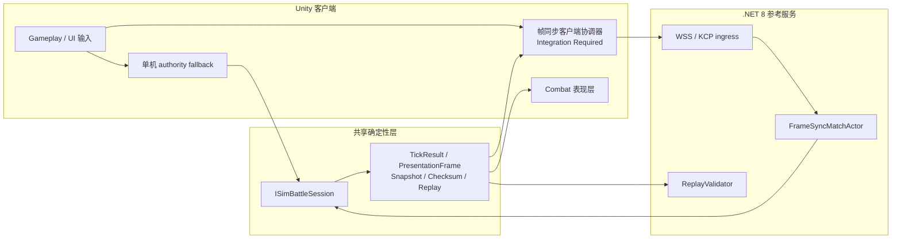
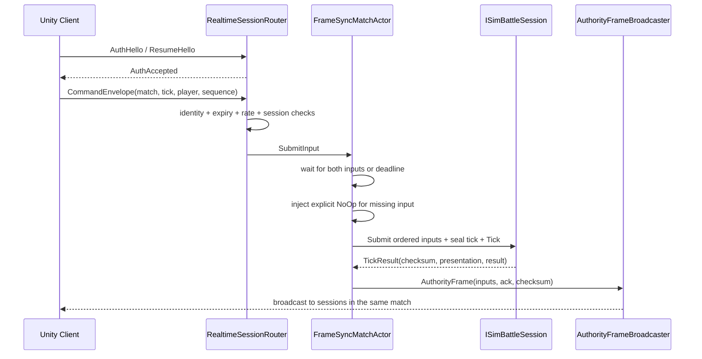

# ZWebGLFrameWork 开发者手册

本文面向准备使用或维护 ZWebGLFrameWork 的 Unity 开发者。阅读顺序按“先跑通单机，再接确定性模拟，最后接网络和权威服务”组织；所有成熟度判断均以当前仓库源码为准。

## 1. 框架定位与成熟度

ZWebGLFrameWork 是面向策略游戏的 Unity 2022.3 通用框架。目标是让同一套确定性战斗逻辑同时服务于三种运行方式：

- 单机模式：本地存档、本地战斗，不依赖服务端。
- 联机客户端：通过 WebGL WSS 或 Native KCP 交换帧同步消息。
- 权威服务：在 .NET 8 中运行相同的 `SimulationCore`，校验输入、推进 tick、广播权威帧并验证 Replay。

文档用以下标记区分“代码存在”和“业务可以直接上线”之间的差异：

| 标记 | 含义 |
|---|---|
| `Ready` | 仓库内已有可执行实现和验证入口，可直接用于框架开发。 |
| `Reference` | 已有可构建、可测试的参考实现，生产部署仍需业务配置、容量与运维建设。 |
| `Integration Required` | 仓库只提供契约、扩展点或 fallback，业务项目必须补齐实现。 |

当前能力矩阵：

| 能力 | 成熟度 | 当前边界 |
|---|---|---|
| 离线启动、五槽位 JSON 存档、单机战斗 | `Ready` | 使用框架默认内容与本地保留身份。 |
| 确定性 `SimulationCore`、snapshot、checksum、Replay 基础流程 | `Ready` | 业务必须保持输入、内容和数值规则确定性。 |
| WebGL WSS、Native KCP、认证 envelope | `Reference` | transport 已实现；客户端帧同步协调器尚未闭环。 |
| .NET 8 FrameSync 组件、RealtimeHost、ReplayValidator CLI | `Reference` | 可构建、可测试；当前 Host 不能分配真实 match。 |
| matchmaker/session 分配、客户端逐 tick 发送和 ack 消费 | `Integration Required` | 必须由业务项目实现。 |
| 客户端预测、rollback/replay、超窗 full resync | `Integration Required` | 协议与 snapshot contract 已有，协调器未实现。 |
| 生产业务内容热更新 | `Integration Required` | 只有 provider/updater 边界，未接 YooAsset/Huatuo。 |

本框架不是现成的生产后端、完整游戏内容包或热更新发行系统。开源使用者应把 `Server/` 看成权威协议和算法的参考实现，而不是可直接扩容上线的服务。

## 2. 快速开始

### 环境

- Unity `2022.3.62f3c1`，版本来源见 [`ProjectVersion.txt`](../ProjectSettings/ProjectVersion.txt)。
- C# 9 / .NET Standard 2.1（Unity 运行时）。
- .NET SDK 8（构建 `Server/` 参考项目和运行服务端测试）。
- 主要目标平台：WebGL；同时保留 Windows、Android、iOS 构建入口。

### 第一次运行单机模式

1. 用 Unity Hub 的 `2022.3.62f3c1` 打开仓库根目录，等待 [`Packages/manifest.json`](../Packages/manifest.json) 中的包恢复完成。
2. 打开启动场景 [`Assets/Scence/Launcher.unity`](../Assets/Scence/Launcher.unity)。该场景已在 [`EditorBuildSettings.asset`](../ProjectSettings/EditorBuildSettings.asset) 中启用。
3. 确认 [`Assets/Resources/Config/AppConfig.asset`](../Assets/Resources/Config/AppConfig.asset) 的 Offline Mode 已开启。字段定义位于 [`AppConfig`](../Assets/Scripts/Data/AppConfig.cs)，默认值为 `true`。
4. 进入 Play Mode。无需在场景中手动挂载 [`GameLauncher`](../Assets/Scripts/FSM/Game/GameLauncher.cs)；它只会在活动场景名为 `Launcher` 时自动创建。
5. 首次运行会在 `Application.persistentDataPath` 创建 `save_0.json`，随后进入主城。点击攻击按钮可进入使用本地权威 fallback 的单机战斗。

如果 `AppConfig.asset` 缺失，框架会创建默认配置并输出错误；这只是降级路径，不应作为正常项目配置。默认战斗内容和本地权威身份也会各输出一次 warning，用来提醒集成者替换 fallback。

### 编译验证

```bash
bash ./ci_build.sh Validate
```

脚本会自动寻找 Unity Hub；找不到时可显式设置 `UNITY_PATH`。其他入口为 `WebGL`、`Windows`、`Android`、`iOS`。只验证 .NET 参考项目时运行：

```bash
dotnet test Server/ZWebGLFrameWork.Server.sln --nologo --verbosity minimal
```

## 3. 统一运行模型

确定性 [`ISimBattleSession`](../Assets/Scripts/SimulationCore/Session/ISimBattleSession.cs) 是三种模式的共同边界。Unity 的输入、网络 transport 和服务端路由都只能提交命令；表现层只消费 `PresentationFrame`，不能直接改模拟状态。



必须维持以下边界：

- `SimulationCore` 不引用 `UnityEngine`，也不读取时间、网络、文件、浮点物理或场景对象。
- tick、玩家、sequence、内容 hash 和初态由调用方显式提供。
- `TickResult.Presentation` 是 Unity 表现输入，`TickResult.Checksum` 是一致性证据。
- 通用 [`ECS`](../Assets/Scripts/ECS) 可用于普通 Unity 运行时组织，但不是权威战斗状态；帧同步状态归 `SimulationCore` 所有。
- 服务端和客户端必须使用相同 canonical manifest、协议版本、schema、初态和有序命令。

## 4. 项目结构与依赖边界

| 路径 | 职责 | 依赖规则 |
|---|---|---|
| [`Assets/Scripts/Core`](../Assets/Scripts/Core) | 单例、事件、日志、资源、场景、音频、SDK 等基础设施 | 不依赖业务模块。 |
| [`Assets/Scripts/Data`](../Assets/Scripts/Data) | 响应式模型、配置、本地存档、业务数据 | 依赖 Core。 |
| [`Assets/Scripts/ECS`](../Assets/Scripts/ECS) | Unity 侧通用轻量 ECS | 依赖 Core，不替代 SimulationCore。 |
| [`Assets/Scripts/SimulationCore`](../Assets/Scripts/SimulationCore) | 确定性世界、命令、模式、session、snapshot、Replay | 无 Unity 引用，是客户端/服务端共享真值。 |
| [`Assets/Scripts/Combat`](../Assets/Scripts/Combat) | Unity 战斗编排、输入适配、表现桥接和 fallback 内容 | 依赖 SimulationCore、Data、Gameplay。 |
| [`Assets/Scripts/Network`](../Assets/Scripts/Network) | 无引擎协议、WSS/KCP adapter、HTTP 和连接生命周期 | Contracts 无 Unity；平台 adapter 依赖 Contracts/Runtime。 |
| [`Assets/Scripts/UI`](../Assets/Scripts/UI) | 六层 UI、栈、生命周期和面板 | 只通过公开模型、事件和表现数据协作。 |
| [`Assets/Scripts/Gameplay`](../Assets/Scripts/Gameplay) | 网格、相机、输入、建筑放置等 Unity 玩法 | 不承载确定性权威结算。 |
| [`Assets/Scripts/FSM`](../Assets/Scripts/FSM) | `Launch -> Login -> MainVillage -> Battle` 全局流程 | 作为组合根依赖 Data、Network、UI、Combat。 |
| [`Server`](../Server) | .NET 8 帧同步、WSS/KCP ingress、ReplayValidator 和测试 | 引用共享 SimulationCore 与 Network.Contracts。 |

新增程序集时遵循“稳定底层不依赖易变上层”：`SimulationCore` 与 `Network.Contracts` 必须继续保持 host-neutral；Unity 表现依赖它们，而不是反向引用。

## 5. 单机模式开发

### 启动和战斗路径

真实调用路径如下：

```text
GameLauncher -> GameFSM -> LaunchState -> LoginState -> MainVillageState
MainVillageState -> FrameworkBattleAuthority -> BattleState
BattleState -> CombatManager -> SimBattleSession
```

[`GameFSM`](../Assets/Scripts/FSM/Game/GameFSM.cs) 注册全局状态；[`LaunchState`](../Assets/Scripts/FSM/Game/States/LaunchState.cs) 初始化资源、数据和配置；[`LoginState`](../Assets/Scripts/FSM/Game/States/LoginState.cs) 在 Offline Mode 下准备本地存档并跳过网络；[`MainVillageState`](../Assets/Scripts/FSM/Game/States/MainVillageState.cs) 从攻击事件创建战斗参数；[`BattleState`](../Assets/Scripts/FSM/Game/States/BattleState.cs) 管理战斗生命周期和结算提交。

[`SaveManager`](../Assets/Scripts/Data/SaveManager.cs) 支持槽位 `0..4`，用 `PlayerPrefs` 保存当前槽位索引，并把明文 JSON 写入 `Application.persistentDataPath`。[`OfflineSaveFlow`](../Assets/Scripts/Data/OfflineSaveFlow.cs) 的顺序是：不存在则创建默认存档，然后校验并加载到 `DataManager`。创建、迁移或写盘失败时流程返回 `false`，UI 应让用户重试或切换槽位，不能假装加载成功。

### 本地 authority 的边界

[`FrameworkBattleAuthority`](../Assets/Scripts/Combat/FrameworkBattleAuthority.cs) 为单机 fallback 生成唯一 `MatchId`、`SessionId` 和稳定 seed，并使用保留的本地玩家身份 `1000/2000`。[`FrameworkBattleContent`](../Assets/Scripts/Combat/FrameworkBattleContent.cs) 提供 TownHall、Cannon、Barbarian 和四种模式的最小 canonical manifest。

这两个类型适合离线开发和演示，但不能用于可信联机结算。正式项目必须由 matchmaker/权威服务签发 match、session、玩家身份、初态、内容版本和提交 nonce，并把结果与持久化账户绑定。

[`CombatManager`](../Assets/Scripts/Combat/CombatManager.cs) 每 `1/20` 秒调用一次 session `Tick()`，把 `TickResult.Presentation` 交给表现桥，并通过以下 API 把 Unity 操作转成确定性命令：

- `SubmitDeployUnit(Vector2Int, int)`
- `SubmitMove(int, Vector2Int)`
- `SubmitSkill(int, int, Vector2Int)`
- `EndDeployPhase()`

这些入口自动使用 `State.NextTick` 和单调递增 sequence。在线模式不能直接复用这条本地提交路径；业务帧同步协调器需要先把本地命令编码并发送，再按权威帧协调预测和重放。

## 6. SimulationCore 使用方法

[`SimBattleSessionFactory`](../Assets/Scripts/SimulationCore/Session/SimBattleSessionFactory.cs) 接收 canonical manifest bytes，返回一次性 session。下面示例使用当前公共 API 构成 `Start -> Submit -> Tick -> Snapshot -> Replay` 最小闭环：

```csharp
using System;
using ZWebGLFrameWork.SimulationCore;

byte[] manifestBytes = new DeterministicContentManifest(
    SimComponentSchema.Version,
    new[]
    {
        new SimArchetypeDefinition(1, "Target", 200, 0, 0, 0, 0),
        new SimArchetypeDefinition(10, "Attacker", 100, 0, 500, 10000, 1),
    },
    new[]
    {
        new SimModeProfile(SimCombatMode.VillageAttack, true, 40, 600, 600,
            Array.Empty<int>()),
        new SimModeProfile(SimCombatMode.BuilderBase, true, 30, 600, 600,
            Array.Empty<int>()),
        new SimModeProfile(SimCombatMode.ClanWar, true, 40, 600, 600,
            Array.Empty<int>()),
        new SimModeProfile(SimCombatMode.Campaign, false, 0, 0, 600,
            new[] { 0 }),
    }).ToCanonicalBytes();

var manifest = DeterministicContentManifest.Parse(manifestBytes);
var init = new BattleInit(
    protocolVersion: 1,
    schemaVersion: SimComponentSchema.Version,
    matchId: "example-match",
    sessionId: "example-session",
    seed: 42,
    tickRate: 20,
    mode: SimCombatMode.VillageAttack,
    contentHash: manifest.ContentHash,
    players: new[]
    {
        new SimPlayerIdentity(0, "attacker"),
        new SimPlayerIdentity(1, "defender"),
    },
    initialEntities: new[]
    {
        new InitialEntitySpec(10, 7, 2, SimTeam.Attacker, 0),
        new InitialEntitySpec(1, 8, 2, SimTeam.Defender, 1),
    },
    inputDeadlineTicks: 6);

using ISimBattleSession session =
    new SimBattleSessionFactory().Create(manifestBytes);

StartResult started = session.Start(init);
if (!started.Accepted)
    throw new InvalidOperationException("Start rejected: " + started.Code);

SimSnapshot checkpoint = session.CaptureSnapshot();
var recorder = new CommandRecorder(init);

CommandSubmitResult submitted = session.Submit(new EndDeploymentCmd
{
    Tick = session.State.NextTick,
    PlayerId = 0,
    Sequence = 1,
});
if (!submitted.Accepted)
    throw new InvalidOperationException(
        "Command rejected: " + submitted.Disposition);

TickResult tick = session.Tick();
recorder.Record(tick);
PresentationFrame frame = tick.Presentation;
ulong checksum = tick.Checksum;
ReplayFile replay = recorder.Export();

SnapshotRestoreResult restored = session.RestoreSnapshot(checkpoint);
if (!restored.Restored)
    throw new InvalidOperationException(
        "Snapshot rejected: " + restored.Code);

using ISimBattleSession replaySession =
    new SimBattleSessionFactory().Create(manifestBytes);
ReplayPlaybackResult playback = ReplayPlayback.Run(replaySession, replay);
```

注意：示例在导出 Replay 后恢复了较早 snapshot，因此之后应以 `restored.FullFrame` 全量刷新表现层。每次成功恢复都会增加 `TimelineRevision`；旧 revision snapshot 会返回 `StaleRevision`。

### 结果处理

不要只检查返回值非空。调用方必须按 [`SessionResults`](../Assets/Scripts/SimulationCore/Session/SessionResults.cs) 和 [`TickResult`](../Assets/Scripts/SimulationCore/Session/TickResult.cs) 的状态码分支：

- `StartResult.Code`：协议、schema、match、内容、玩家、初始实体或模式不匹配时拒绝。
- `CommandSubmitResult.Disposition`：区分重复/倒序 sequence、late tick、future window、未知玩家、错误阶段、非法 payload 和越权实体。
- `TickResult.Code`：只有 `Advanced` 或 `Ended` 表示实际推进；`NotRunning`、`Disposed` 不得当成空 tick。
- `SnapshotRestoreResult.Code`：校验 match、session、schema、内容 hash、revision、大小、payload hash 和内部状态。

### 确定性约束

- 模拟数值使用 [`LogicInt`](../Assets/Scripts/SimulationCore/Math/LogicInt.cs) 或整数，不引入 `float`/`double` 作为权威状态。
- 迭代顺序、命令顺序和序列化字段必须稳定；不要依赖无序容器枚举结果。
- 不读取 `Time.*`、`UnityEngine.Random`、系统时间或平台文件。
- canonical manifest 变化必须更新内容 hash，并保证 Unity 和 .NET 8 使用完全相同的 bytes。
- UI 和视图只能读取 [`PresentationFrame`](../Assets/Scripts/SimulationCore/Presentation/PresentationFrame.cs)，不能回写世界。

## 7. 网络层接入

[`IRealtimeChannel`](../Assets/Scripts/Network/Contracts/Transport/IRealtimeChannel.cs) 统一暴露 `ConnectAsync`、`SendAsync`、`ReceiveAsync`、`CloseAsync` 和连接状态。[`RealtimeConnectionController`](../Assets/Scripts/Network/Runtime/RealtimeConnectionController.cs) 管理替换连接、取消过期连接和释放 transport。

平台选择：

| 平台 | Transport | 实现 | 端点要求 |
|---|---|---|---|
| WebGL / Editor | `RealtimeTransport.WebSocket` | [`WebGlRealtimeChannel`](../Assets/Scripts/Network/WebGL/WebGlRealtimeChannel.cs) | `wss://.../v1/realtime`，子协议 `zweb.framesync.v1`。 |
| Windows / Editor | `RealtimeTransport.NativeKcp` | [`Kcp2kRealtimeChannel`](../Assets/Scripts/Network/Native/Kcp2kRealtimeChannel.cs) | 有效 host 和 `1..65535` 端口，例如 `kcp://127.0.0.1:7777`。 |

两个平台工厂在 `BeforeSceneLoad` 自动注册到 [`RealtimeChannelFactoryRegistry`](../Assets/Scripts/Network/Runtime/RealtimeChannelFactoryRegistry.cs)。若程序集没有被目标平台包含，`Create` 会报告未注册，不应降级到错误 transport。

连接所需的 [`RealtimeCredentials`](../Assets/Scripts/Network/Contracts/Protocol/RealtimeModels.cs) 由 HTTPS guest/login 或业务认证服务返回，包含 `SessionId`、opaque ticket、resume token、32-byte MAC key 和过期时间。Unity 的 [`GuestLoginResult`](../Assets/Scripts/Network/UnityHttp/GuestLoginModels.cs) 会拒绝非 2xx、格式错误、空字段、过期凭据和错误 key 长度。

```csharp
using System;
using System.Threading;
using ZWebGLFrameWork.FSM;
using ZWebGLFrameWork.Network;
using ZWebGLFrameWork.Network.Contracts.Protocol;

RealtimeCredentials credentials = NetworkSession.Current.Credentials;

#if UNITY_WEBGL
var endpoint = new RealtimeEndpoint(
    RealtimeTransport.WebSocket,
    new Uri(GameLauncher.Config.WssRealtimeUrl));
#else
var endpoint = new RealtimeEndpoint(
    RealtimeTransport.NativeKcp,
    new Uri("kcp://127.0.0.1:7777"));
#endif

await NetworkManager.Instance.Realtime.ConnectAsync(
    endpoint, credentials, CancellationToken.None);
```

[`RealtimeProtocol`](../Assets/Scripts/Network/Contracts/Protocol/RealtimeProtocol.cs) 当前版本为 `1`，最大消息 payload 为 65536 bytes，rollback window 常量为 64 ticks。WSS 在连接阶段发送 `AuthHello`；Native KCP 在认证后用 sequence + HMAC-SHA256 包装完整消息，并用 1024-packet replay window 拒绝重放。

### 仍需业务实现的客户端闭环

transport 连接成功不等于帧同步已接通。业务项目还必须实现：

1. 每 tick 把本地 `ISimCommand` 映射成 versioned `CommandEnvelope`，维护单调 sequence，并用 [`RealtimeCodec`](../Assets/Scripts/Network/Contracts/Protocol/RealtimeCodec.cs) 编码发送。
2. 单线程消费 `ReceiveAsync`，严格检查 decode error、message kind、match、tick 和 revision。
3. 用 `AuthorityFrame.AckForPlayer` 清理本地重发队列，并按 `OrderedInputs` 重放权威顺序。
4. 比较每 tick checksum；不一致时恢复合适 snapshot 并重放，超出 64-tick window 时请求 full resync。
5. 用 `ResumeHello` 的 accepted sequence、authority tick 和 revision 恢复短断线；凭据过期或状态不匹配时重新登录。

认证失败、错误 session/player、消息过大、限流、late input 和过期 ticket 都是可观察的 [`ProtocolError`](../Assets/Scripts/Network/Contracts/Protocol/RealtimeProtocol.cs)，不能被统一吞成“网络断开”。

## 8. 帧同步参考服务端

服务端组件位于 [`Server/FrameSync`](../Server/FrameSync)，入口 Host 位于 [`Server/RealtimeHost`](../Server/RealtimeHost)。其核心数据流为：



[`RealtimeSessionRouter`](../Server/FrameSync/RealtimeSessionRouter.cs) 验证 ticket/resume、连接所有权、过期时间、rate、player 和 match；短断线状态保留 10 秒。[`FrameSyncMatchActor`](../Server/FrameSync/FrameSyncMatchActor.cs) 按 monotonic clock 计算 deadline，双方输入齐全或 deadline 到达后封存 tick，对缺失玩家插入显式 NoOp；单次 `Pump()` 最多追赶 4 ticks。[`AuthorityFrameBroadcaster`](../Server/FrameSync/AuthorityFrameBroadcaster.cs) 只向相同 match 的已注册 session 广播，并隔离单个坏连接的发送异常。

### 构建和本地启动

```bash
dotnet restore Server/ZWebGLFrameWork.Server.sln --locked-mode
dotnet build Server/ZWebGLFrameWork.Server.sln -c Release --no-restore --warnaserror
dotnet run --project Server/RealtimeHost/ZWebGLFrameWork.RealtimeHost.csproj -c Release
```

默认配置见 [`appsettings.json`](../Server/RealtimeHost/appsettings.json)：HTTPS/WSS 为 `https://127.0.0.1:7443`，Native KCP 为 `7777`，每 session 64 messages/s、burst 128。WSS 需要本机可信的 ASP.NET Core 开发证书，并且浏览器 Origin 必须在 `AllowedOrigins` 中。

### 重要限制

当前 [`Program.cs`](../Server/RealtimeHost/Program.cs) 显式使用 `UnavailableLoginAllocator`：`POST /v1/login/guest` 返回 503，Host 不会创建正式 match。当前 Host 也没有接入以下组合根工作：

- 从正式内容和权威初态创建并 `Start` `ISimBattleSession`；
- 创建 `FrameSyncMatchActor` 并注册到 `FrameSyncMatchRegistry`；
- 以 20 Hz monotonic scheduler 调用 actor `Pump()`；
- match 结束后的释放、结果持久化和容量治理；
- 把 resume 进度、buffered authority frames 与超窗 full snapshot 接成完整恢复路径。

因此，仓库提供的是可测试的协议、路由、actor 和 ingress 参考组件，不是可直接联机的生产服务。业务集成应实现 `IRealtimeLoginAllocator` 和正式 match factory/scheduler，并增加 WSS-WSS、KCP-KCP、混合 transport 的真实端到端测试。

## 9. 框架扩展工作流

### 新增确定性命令

一次命令扩展至少同步修改：

1. 在 [`ISimCommand.cs`](../Assets/Scripts/SimulationCore/Command/ISimCommand.cs) 增加稳定的 `SimCommandType` 数值并定义 payload struct。
2. 在 `SimBattleSession` 增加提交校验和执行逻辑，所有 rejection 使用明确 `CommandDisposition`。
3. 在 [`CommandRecorder`](../Assets/Scripts/SimulationCore/Command/CommandRecorder.cs) 增加 Replay 序列化/反序列化。
4. 在线命令同步更新 [`FrameSyncCommandCodec`](../Assets/Scripts/Network/Contracts/Protocol/FrameSyncCommandCodec.cs) 和服务端 [`FrameworkAuthorityCommandMapper`](../Server/FrameSync/FrameworkAuthorityCommandMapper.cs)。
5. 更新 Replay strict schema、资源限制相关测试、Unity/.NET golden tests，并明确协议兼容策略。

不要复用旧 message ID 表示不同语义，也不要让 Unity 对象引用进入命令 payload。

### 新增确定性内容或战斗模式

业务内容由 [`DeterministicContentManifest`](../Assets/Scripts/SimulationCore/Content/DeterministicContentManifest.cs) 生成 canonical bytes。新增 archetype 时使用稳定正整数 ID、整数/`LogicInt` 原始值，并同步客户端与服务端内容来源。

当前模式不是继承体系。新增模式需同步更新 `SimCombatMode`、manifest 的支持/完整性校验、[`SimModeRules`](../Assets/Scripts/SimulationCore/Modes/SimModeRules.cs)、`BattleInitFactory` 的字符串映射、fallback 内容以及模式和 Replay golden tests。不要只增加 UI 枚举后让 session 静默回退。

生产内容热更新应实现 [`IBusinessContentUpdater`](../Assets/Scripts/Core/Resource/BusinessContentUpdate.cs)，成功后通过 [`ResourceManager.SetBusinessProvider`](../Assets/Scripts/Core/Resource/ResourceManager.cs) 只替换业务 provider。框架资源固定本地 provider。当前未集成 YooAsset/Huatuo，因此该能力仍为 `Integration Required`。

### 新增 UI 面板

1. 在 `Assets/Scripts/UI/Panels/` 新建继承 [`UIBase`](../Assets/Scripts/UI/Core/UIBase.cs) 的面板。
2. 选择 `UILayer`，在 `OnOpen` 订阅事件，在 `OnClose` 对称取消；静态层级使用 `BuildOnce`，重复打开的数据刷新使用 `OnRebind`。
3. 可将 prefab 放在 `Assets/Resources/UI/Panels/<TypeName>.prefab`；缺少 prefab 时 `UIManager` 会动态创建 GameObject。
4. 用 `UIManager.Instance.Open<T>(data)` / `Close<T>()` 管理生命周期，不直接销毁缓存面板。

### 新增 transport 或 provider

新增实时传输时实现 `IRealtimeChannel` 和 `IRealtimeChannelFactory`，为新 `RealtimeTransport` 注册工厂，并覆盖连接替换、取消、认证、收发上限、关闭、重放与错误映射测试。不要让上层 `NetworkManager` 判断具体 socket 类型。

新增资源 provider 时实现 [`IResourceProvider`](../Assets/Scripts/Core/Resource/IResourceProvider.cs)，明确同步加载能力、缓存失效和卸载语义。生产业务 provider 通过业务更新器安装，不能替换 framework provider。

## 10. Replay 与问题定位

[`CommandRecorder`](../Assets/Scripts/SimulationCore/Command/CommandRecorder.cs) 应记录 `TickResult.ExecutedCommands` 和该 tick checksum，而不是记录尚未执行的客户端意图。在线可信上传还必须携带服务端签发的 `SimulationSchemaHash`、`ContentConfigHash`、`InitialStateHash` 和 `SubmissionNonce`。

本地回放可用 `ReplayPlayback.Run(session, replay)`；权威校验使用 [`ReplayValidator`](../Server/ReplayValidator/ReplayValidator.cs) CLI：

```bash
dotnet run --project Server/ReplayValidator/ReplayValidator.csproj -- \
  validate \
  --replay Server/TestData/Replay/valid-replay.json \
  --match Server/TestData/Replay/valid-match.json \
  --limits Server/TestData/Replay/replay-limits.json \
  --submitter player-0
```

CLI 向 stdout 输出稳定 JSON，退出码如下：

| 退出码 | 类别 | 含义 |
|---|---|---|
| `0` | `valid` | 权威身份、结构、逐 tick checksum 和终局结果均一致。 |
| `1` | `io` / `internal` | 参数、文件或内部执行失败。 |
| `2` | `invalid-replay` | JSON、命令、tick、checksum、终局或尾随记录非法。 |
| `3` | `unsupported` | Replay/version/schema 不受支持。 |
| `4` | `authority` | match、submitter、nonce、内容、初态或 tick rate 与权威记录不符。 |
| `5` | `resource-limit` | 超过批准的文件、tick、命令、实体、snapshot 或预算上限。 |

批准上限由 [`ReplayValidationLimits`](../Server/ReplayValidator/ReplayValidationLimits.cs) 固定：16 MiB 文件、12000 ticks、每 tick 64 命令、总计 100000 命令、4096 初始实体、8 MiB 解压 snapshot。部署时可以增加外部超时作为安全取消，但不能用不稳定 wall-clock 截断替代确定性数量/字节门禁。

### 固定排查顺序

发生不同步时按以下顺序定位，不要直接改模拟状态掩盖分歧：

1. 协议与身份：version、schema、content hash、match/session/player、ticket/nonce。
2. 时序：tick、sequence、ack、deadline、timeline revision，检查 late/future/replay rejection。
3. 权威输入：逐 tick 比较双方 `OrderedInputs`，包括服务端插入的 NoOp。
4. 状态证据：定位第一个 checksum mismatch，再比较该点前的 canonical snapshot。
5. 只在确认第一处分歧后检查命令执行结果、系统顺序、内容值或序列化差异。

断线在 10 秒 retention 内仍必须精确匹配 resume token、last accepted sequence、last authority tick 和 revision；超出 retention 或 rollback window 后，由业务 full resync 流程接管。

## 11. 测试与构建门禁

仓库已有 Unity EditMode/PlayMode 和 .NET 8 测试。提交前至少执行与变更范围匹配的集合：

```bash
# Unity 编译与启动资产验证
bash ./ci_build.sh Validate

# .NET 8 FrameSync、Network contracts、ReplayValidator
dotnet test Server/ZWebGLFrameWork.Server.sln --nologo --verbosity minimal

# 文档和补丁基本检查
git diff --check
```

Unity Test Runner 中运行：

- EditMode：SimulationCore、Network、ECS、Editor 和基础模块测试。
- PlayMode：Runtime、Combat 生命周期和场景集成测试。

CI 定义位于 [`.github/workflows/ci.yml`](../.github/workflows/ci.yml)，包含：审计门禁、Ubuntu Unity EditMode/PlayMode、Linux/Windows .NET 8 restore/build/test、WebGL/Windows 构建和 smoke 验证。服务端 CI 使用 locked restore、Release、warnings-as-errors；本地只运行 `dotnet test` 不能替代完整发布门禁。

提交前检查清单：

- Unity 和 .NET 8 对同一 manifest/命令的 golden checksum 一致。
- 新协议字段有严格长度、范围、版本、身份和重放测试。
- snapshot/replay 变更覆盖 corrupt、foreign、stale、oversized 和终局路径。
- 新 UI/transport/provider 覆盖取消、关闭、重复进入和资源释放。
- 没有提交 `Library/`、`Temp/`、`BuildLogs/`、IDE 设置或本地存档。

## 12. 已知边界与贡献规范

### 当前未闭环能力

- `RealtimeHost` 的正式 matchmaker、session allocation、权威内容/初态创建和 actor scheduler。
- Unity 客户端逐 tick sender、ack/retransmit 队列和权威帧消费循环。
- 客户端预测、rollback/replay 协调器和超窗 full resync。
- 生产账户、结果持久化、反作弊、服务发现、容量、监控、证书和密钥轮换。
- YooAsset/Huatuo 业务内容和代码热更新实现。
- Android/iOS 原生实时 transport；当前 Native KCP asmdef 只包含 Editor 和 WindowsStandalone64。

### 贡献规则

- 保持变更小而可验证，不顺手重构无关模块。
- 公共类型放入对应 `ZWebGLFrameWork.<Module>` 命名空间，并维护 asmdef 的单向依赖。
- 确定性行为优先写跨 Unity/.NET 8 测试；修复 bug 时先增加可复现测试。
- 协议和 Replay contract 必须版本化，未知字段/类型默认拒绝，不能静默截断。
- 新增生产集成前先保留清晰接口和失败状态，不伪造成功路径。

以下变化必须在同一提交中更新本手册：公共 API、启动/FSM 路径、运行模式、协议版本或 envelope、transport/认证、SimulationCore 命令、snapshot/checksum/Replay contract、扩展点、构建命令、最低环境版本，以及任何能力在 `Integration Required`、`Reference`、`Ready` 之间的变化。

根 `README.md` 只维护定位、环境、顶层能力和本手册入口；本文件是开源开发使用说明的唯一正文。代码评审应把它视为公共接口的一部分。
